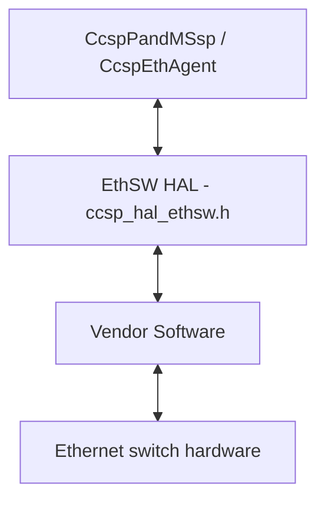
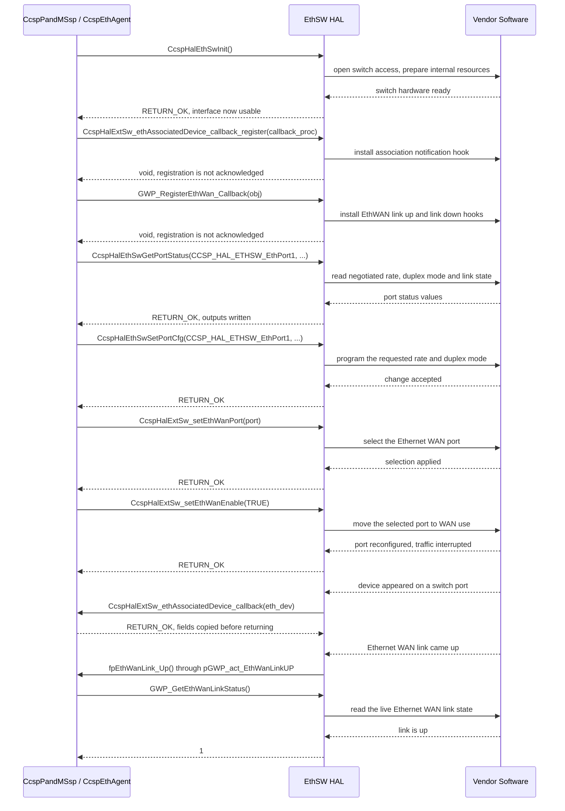

# ETHSW HAL Documentation

## Version History

| Date | Comment | Version |
| --- | --- | --- |
| 2024-08-13 | Initial release. EthSW HAL header migrated to GitHub. | 1.0.0 |
| 2024-09-16 | Header corrections: a stray comment terminator removed, and `CcspHalExtSw_getCurrentWanHWConf()` placed behind `FEATURE_RDKB_AUTO_PORT_SWITCH`. | 1.0.1 |
| 2024-09-25 | `ETH_5_PORTS` added to the `ETHWAN_DEF_INTF_NUM` ladder (`pri#7`, `RDKCOM-5064`). | 1.1.0 |
| 2026-08-24 | Specification rewritten to the canonical RDK-B HAL topic set: every declared function named in `API Surface`, the asynchronous notification path corrected, and the unresolved footprint and timeout requirements replaced with explicit statements. Describes the interface at tag `1.1.0`. | 1.1.0 |

## Acronyms

- `ACL` \- Access Control List
- `API` \- Application Programming Interface
- `DSCP` \- Differentiated Services Code Point
- `ETHSW` \- Ethernet Switch
- `HAL` \- Hardware Abstraction Layer
- `IGMP` \- Internet Group Management Protocol
- `LAN` \- Local Area Network
- `MAC` \- Media Access Control
- `MLD` \- Multicast Listener Discovery
- `MoCA` \- Multimedia over Coax Alliance
- `QoS` \- Quality of Service
- `RDK-B` \- Reference Design Kit for Broadband
- `SoC` \- System on Chip
- `VLAN` \- Virtual Local Area Network
- `WAN` \- Wide Area Network

## Description

The diagram below describes a high-level software architecture of the EthSW HAL module stack.



The Ethernet Switch Hardware Abstraction Layer, `ccsp_hal_ethsw`, is the interface through
which `CcspPandMSsp` and `CcspEthAgent` read and control the Ethernet switch of an RDK-B
broadband gateway. The header declares the contract and a vendor supplies the implementation
behind it. A caller works in terms of port identifiers, link rates, duplex modes,
administrative states and counters, and the same call sequence produces the same result on any
product whose vendor implements the contract.

**Scope of this interface:** The contract is the twenty functions listed under `API Surface`:
initialisation, port status and configuration, forwarding-table maintenance, connected-device
enumeration with its notification callback, Ethernet WAN selection, provisioning and link
events, and per-port statistics. `VLAN` management, `QoS` and `DSCP` priority, `ACL`, bridging,
link aggregation, and `IGMP` and `MLD` multicast control are not part of this contract:
`eth_vlanid` in `eth_device_t` is a reported attribute of an observed device, and
`MulticastPacketsSent` and `MulticastPacketsReceived` in `CCSP_HAL_ETH_STATS` are counters.

## Optional Components

Two functions are compiled conditionally:

- `CcspHalExtSw_ethPortConfigure()` is declared only when **both** `FEATURE_RDKB_WAN_MANAGER`
  and `FEATURE_RDKB_AUTO_PORT_SWITCH` are defined.
- `CcspHalExtSw_getCurrentWanHWConf()` is declared only when `FEATURE_RDKB_AUTO_PORT_SWITCH` is
  defined.

Calling code must be guarded by the same macros as the declaration it calls, because an
unguarded call to an absent function fails at build time. Every other function in
`API Surface` is unconditional.

## Component Runtime Execution Requirements

### Initialization and Startup

A caller invokes the following initialization API **once** during bootup, before any other API
of this interface.

- `CcspHalEthSwInit()`

That call binds a caller as follows:

- **Mandatory initialization:** every other function of this interface may be called only
  after `CcspHalEthSwInit()` has returned `RETURN_OK`. On `RETURN_ERR` a caller calls no other
  function, and retries the call or reports the failure.
- **Blocking behaviour:** `CcspHalEthSwInit()` may block while the Ethernet switch hardware is
  not yet ready, so a caller must not invoke it from a context that cannot tolerate a delay.
- **No teardown counterpart:** there is no de-initialization function to call at shutdown, and
  a caller must not repeat `CcspHalEthSwInit()` to reset the HAL.

Third party vendors will implement appropriately to meet operational requirements, taking the
blocking behaviour above into account.

### Threading Model

EthSW HAL is not thread safe, any module which is invoking the EthSW HAL api should ensure
calls are made in a thread safe manner. This includes the two registration functions: a caller
must not register a callback on one thread while another thread is calling this interface.

Vendors may implement internal threading and event mechanisms to meet their operational
requirements. These mechanisms must be designed to ensure thread safety when interacting with
HAL interface. Proper cleanup of allocated resources (e.g., memory, file handles, threads) is
mandatory when the vendor software terminates or closes its connection to the HAL.

### Process Model

All APIs are expected to be called from multiple processes. Due to this concurrent access,
vendors must implement protection mechanisms within their API implementations to handle
multiple processes calling the same API simultaneously. This is crucial to ensure data
integrity, prevent race conditions, and maintain the overall stability and reliability of the
system.

### Memory Model

Storage exchanged across this interface is allocated and released by the caller.
`CcspHalExtSw_getAssociatedDevice()` is the one exception: the HAL allocates the array it
returns and the caller releases it.

#### Caller Responsibilities

- Allocate every `[out]` structure and buffer before the call, and release it only once the
  implementation's use of it has ended: the `CCSP_HAL_ETH_STATS` passed to
  `CcspHalEthSwGetEthPortStats()` and the `GWP_GetEthWanInterfaceName()` buffer stay allocated
  and unmoved after the call returns.
- Keep every `[in]` buffer valid for the duration of the call, and keep a registered
  `appCallBack` valid for as long as notifications are wanted.
- Pass no NULL pointer where a parameter is required.
- Size the `GWP_GetEthWanInterfaceName()` buffer to the capacity established with the vendor
  implementation (see `Platform or Product Customization`), zero-fill it before the call, and
  pass its real size as `maxSize`.
- Release the `eth_device_t` array returned by `CcspHalExtSw_getAssociatedDevice()` with the
  deallocator the vendor implementation documents. On `RETURN_ERR` there is no array to
  release.

#### Module Responsibilities

- Handle and deallocate memory used for internal operations, and release all internally
  allocated memory when the connection to the caller ends, so that nothing leaks.
- Write only within the bounds a caller supplied, honouring `maxSize`.
- Allocate the `eth_device_t` array returned by `CcspHalExtSw_getAssociatedDevice()` and hand
  its ownership to the caller.

### Power Management Requirements

The EthSW HAL is not involved in any of the power management operation.

### Asynchronous Notification Model

This interface has two asynchronous notification paths, each installed by a registration
function that the header marks with the generator's `execution` alias, value `callback`:

- `CcspHalExtSw_ethAssociatedDevice_callback_register()` installs a
  `CcspHalExtSw_ethAssociatedDevice_callback`, which the implementation invokes each time a
  device associates with or disassociates from a switch port. The callback receives an
  `eth_device_t`, whose `eth_Active` distinguishes an arrival from a departure. This replaces
  polling `CcspHalExtSw_getAssociatedDevice()`.
- `GWP_RegisterEthWan_Callback()` installs the Ethernet WAN link callbacks a caller supplies in
  an `appCallBack`: `fpEthWanLink_Up` in `pGWP_act_EthWanLinkUP` and `fpEthWanLink_Down` in
  `pGWP_act_EthWanLinkDown`. They take no argument, so a caller that needs the port, the
  interface name or the link state queries `CcspHalExtSw_getEthWanPort()`,
  `GWP_GetEthWanInterfaceName()` or `GWP_GetEthWanLinkStatus()`. This replaces polling
  `GWP_GetEthWanLinkStatus()`.

A caller using either path:

- protects its own state, does not assume a callback runs on the registering thread, and
  returns promptly, deferring real work;
- copies any `eth_device_t` field it needs during the callback, releases nothing, and does not
  keep the pointer;
- registers once, supplies every callback function, and keeps them callable for as long as the
  process runs. Both registration functions return `void`, so arriving notifications are the
  only confirmation that registration succeeded.

### Blocking calls

**Synchronous and Responsive:** All APIs within this module should operate synchronously and
complete within a reasonable timeframe based on the complexity of the operation.

**Non-Blocking Requirement:** Given the single-threaded environment in which these APIs will be
called, it is imperative that they do not block or suspend execution of the main thread.
Implementations must avoid long-running operations or utilize asynchronous mechanisms where
necessary to maintain responsiveness. The two registration functions install a callback and
return without waiting for an event.

`CcspHalEthSwInit()` is the one exception; see `Initialization and Startup`.

### Internal Error Handling

Every function except the two `void` registration functions (see
`Asynchronous Notification Model`) reports its result synchronously in its return value, which
a caller acts on as follows:

| Function | Return value | Caller action |
| --- | --- | --- |
| Every status-returning function | `RETURN_OK` (0) | Success; the outputs are valid. |
| Every status-returning function | `RETURN_ERR` (-1), the only failure value | Treat the outputs as unset, validate the arguments, then retry or report the failure. The value does not identify the cause; consult `ethsw_vendor_hal.log`. |
| `GWP_GetEthWanLinkStatus()` | `1`, `0` or a negative value | `1` is link up and `0` link down. A negative value means the state could not be determined: test for it first and never treat it as down. |
| `CcspHalExtSw_getCurrentWanHWConf()` | `TRUE` or `FALSE` | `TRUE` is a hardware WAN configuration. A failed query also returns `FALSE`, so only `TRUE` is a definite answer. |

### Persistence Model

There is no requirement for HAL to persist any setting information. A caller re-applies port
configuration, administrative state, aging speed and Ethernet WAN selection after
re-initialisation.

## Non functional requirements

Following non functional requirement should be supported by the EthSW HAL component.

### Logging and debugging requirements

The component is required to record all errors and critical informative messages to aid in
identifying, debugging, and understanding the functional flow of the system. Logging should be
implemented using the syslog method, as it provides robust logging capabilities suited for
system-level software. The use of `printf` is discouraged unless `syslog` is not available.

All HAL components must adhere to a consistent logging process. When logging is necessary, it
should be performed into the `ethsw_vendor_hal.log` file, which is located in either the
`/var/tmp/` or `/rdklogs/logs/` directories.

Log levels follow the Linux standard logging system, in descending order of severity: `FATAL`,
`ERROR`, `WARNING`, `NOTICE`, `INFO`, `DEBUG` and `TRACE`. Each log entry carries a timestamp, the
log level and a message describing the event or condition.

Implementations must not log credentials, secrets, security-sensitive information, or other sensitive data.
Sensitive data includes personal data such as client device addresses. The rule applies at every
log level, `DEBUG` and `TRACE` included, and to crash dumps, support bundles and telemetry.

### Memory and performance requirements

The component should be designed for efficiency, minimizing its impact on system resources
during normal operation. Resource utilization (e.g., CPU, memory) should be proportional to the
specific task being performed and align with any performance expectations documented in the API
specifications.

### Quality Control

An implementation should pass analysis with third-party tools such as `Coverity`, `Black Duck`
and `Valgrind` without reported issues. Neither the HAL implementation nor the vendor software
beneath it may introduce memory leaks or memory corruption.

Any change to a file listed under `Source References` obliges a review of this document by the
code owner listed in `.github/CODEOWNERS`.

### Licensing

The interface definition is licensed under the Apache License 2.0, with the full text in `LICENSE`
and the attribution notice in `NOTICE`. An implementation of this interface is expected to be
released under the Apache License 2.0.

### Build Requirements

The source code should be capable of, but not be limited to, building under the Yocto
distribution environment. The recipe should deliver a shared library named as
`libhal_ethsw.so`.

To use this interface:

1. Components/Process must include `ccsp_hal_ethsw.h` to make use of EthSW HAL capabilities.
2. Components/Process should add linker dependency for `libhal_ethsw.so`.

### Variability Management

Changes to the interface are controlled by versioning. Vendors implement a designated version of
the interface and move to later versions as their service agreements require. Each interface
version follows [Semantic Versioning 2.0.0](https://semver.org/spec/v2.0.0.html), and vendor code
complies with a specific version.

The interface version is identified by the repository's release tag; this document describes
release `1.1.0`. Code that must behave differently across revisions takes the revision from its
own build configuration. The macros under `Platform or Product Customization` select which
declarations exist and do not identify a version.

### Platform or Product Customization

The product can be configured via the following compile time defines:

```c
FEATURE_RDKB_WAN_MANAGER        # Enable the WAN Manager
FEATURE_RDKB_AUTO_PORT_SWITCH   # Enable the RDKB Auto Port Switch
```

These macros select the optional functions listed under `Optional Components`, so a product
that defines neither has an interface of eighteen functions. `docs/generate_docs.sh` predefines
both for the documentation build, so the generated API reference documents all twenty; a
product build is unaffected.

A second compile-time customization selects the default Ethernet WAN interface index. The
header sets `ETHWAN_DEF_INTF_NUM` from the first matching hardware-configuration macro:

| Compile-time macros defined | `ETHWAN_DEF_INTF_NUM` |
| --- | --- |
| `ETH_6_PORTS` | 5 |
| `ETH_5_PORTS` | 4 |
| `ETH_4_PORTS` | 3 |
| `ETH_2_PORTS` and `MODEM_ONLY_SUPPORT` | 0 |
| none of the above | 0 |

The index is 0-based (see `Theory of operation and key concepts`) and fixed when the header is
compiled. A caller that needs a different Ethernet WAN port calls `CcspHalExtSw_setEthWanPort()`,
which changes the selected port and leaves the compile-time default unchanged.

`ETHWAN_INTERFACE_NAME_MAX_LENGTH`, value 32, is guarded, so a product can define it before
including the header. The `GWP_GetEthWanInterfaceName()` contract also describes a buffer of
at least 64 bytes and a `maxSize` of 11 to 262 bytes. The three figures do not agree, so none
of them is a size that is safe for every implementation: a caller establishes the effective
buffer capacity and the `maxSize` values the vendor implementation accepts before use.

## Interface API Documentation

### Theory of operation and key concepts

This document and the `ccsp_hal_ethsw.h` header define the Ethernet Switch Hardware Abstraction
Layer (HAL) within the RDK-B framework. The header carries the declarations, the types a caller
constructs or interprets, and a per-function contract stating argument ranges, pre-conditions,
post-conditions, return values and the caller's recovery action. This document states the
properties that hold across the whole interface, and `API Surface` lists every declared
function.

Two concepts run through the whole interface and are easy to get wrong.

**A port is identified in several unrelated numbering schemes:** The switch ports that
`CcspHalEthSwGetPortStatus()`, `CcspHalEthSwGetPortCfg()`, `CcspHalEthSwSetPortCfg()`,
`CcspHalEthSwGetPortAdminStatus()`, `CcspHalEthSwSetPortAdminStatus()`,
`CcspHalEthSwSetAgingSpeed()` and `CcspHalEthSwGetEthPortStats()` act on are named by the
1-based `CCSP_HAL_ETHSW_PORT` enumeration, whose first value `CCSP_HAL_ETHSW_EthPort1` is 1.
The Ethernet WAN port that `CcspHalExtSw_getEthWanPort()` and `CcspHalExtSw_setEthWanPort()`
carry, and the value of `ETHWAN_DEF_INTF_NUM`, are a 0-based index instead, and a caller obtains
the number of external Ethernet ports from the platform rather than from `CCSP_HAL_ETHSW_PORT`.
The `eth_port` member of `eth_device_t` and the port number
`CcspHalEthSwLocatePortByMacAddress()` writes use a vendor-defined numbering and are not
`CCSP_HAL_ETHSW_PORT` enumerators. A caller never passes a value from one scheme to a function
that expects another, and establishes the meaning of a located port number or a reported
`eth_port` with the vendor implementation before acting on it.

**An administrative state and a link state are independent facts:** The administrative state is
what an operator requested, read with `CcspHalEthSwGetPortAdminStatus()` and set with
`CcspHalEthSwSetPortAdminStatus()`. The link state is what the hardware currently has, read
with `CcspHalEthSwGetPortStatus()`. A port can be administratively up while its link is down,
so a caller reads the state it actually needs rather than deducing one from the other. The
same distinction separates the three Ethernet WAN views: `CcspHalExtSw_getEthWanEnable()`
reports the feature setting, `GWP_GetEthWanLinkStatus()` reports the live link, and
`CcspHalExtSw_getCurrentWanHWConf()` reports which hardware configuration the product is in.

#### Object Lifecycles

- **No created objects:** the HAL manipulates the state and configuration of Ethernet switch
  hardware that already exists, and identifies what to act on by parameter: a
  `CCSP_HAL_ETHSW_PORT` enumerator, an Ethernet WAN port index, or a MAC address. Those
  identifiers are properties of the hardware, not handles this interface issues.
- **Storage:** ownership follows `Memory Model`; `CcspHalExtSw_getAssociatedDevice()` makes the
  one HAL allocation, which the caller releases.
- **Interface lifetime:** the interface stays open from a successful `CcspHalEthSwInit()` for
  the life of the process, and a caller keeps its registered callbacks callable for the same
  period, as `Initialization and Startup` and `Asynchronous Notification Model` state.

#### Method Sequencing

- **Initialization first:** every sequence below starts after the successful initialization that
  `Initialization and Startup` requires.
- **Registration before the events matter:** install the association callback and the Ethernet
  WAN link callbacks after initialization and before the caller depends on being notified,
  because events that occur before registration are not replayed.
- **Select, then enable, for Ethernet WAN:** `CcspHalExtSw_setEthWanEnable()` acts on the port
  that `CcspHalExtSw_getEthWanPort()` reports, so a caller that wants a specific port calls
  `CcspHalExtSw_setEthWanPort()` first. Where the automatic port-switch feature is built,
  `CcspHalExtSw_ethPortConfigure()` performs the equivalent change by interface name instead of
  by index.
- **Read back rather than assume:** after a failed `CcspHalExtSw_setEthWanEnable()` or
  `CcspHalExtSw_ethPortConfigure()` the change may have been partially applied, so a caller
  re-reads the state with `CcspHalExtSw_getEthWanEnable()` and `CcspHalExtSw_getEthWanPort()`.
  An aging speed set with `CcspHalEthSwSetAgingSpeed()` has no getter, so a caller records the
  value it set.
- **Otherwise unordered:** the remaining getters and setters may be called in any order after
  initialization, subject to the serialization `Threading Model` requires.

#### State-Dependent Behavior

- **Port existence:** a port-scoped call is meaningful only for a port the product implements,
  so a caller handles `RETURN_ERR` for a valid `CCSP_HAL_ETHSW_PORT` enumerator on hardware
  that has no such port, and for a link rate the port does not support.
  `CCSP_HAL_ETHSW_PortMax` is a count and sentinel rather than a port, and passing it is an
  invalid argument.
- **Link state:** `CcspHalEthSwGetPortStatus()` reports what a port has negotiated, which is
  not necessarily what it was configured for. `CcspHalEthSwGetPortCfg()` reports the
  configuration. With `CCSP_HAL_ETHSW_LINK_Auto` or `CCSP_HAL_ETHSW_DUPLEX_Auto` configured, a
  read returns the negotiated rate or mode once a link is up rather than the `Auto` value.
- **Administrative state:** a port in `CCSP_HAL_ETHSW_AdminDown` will not establish a link.
  `CCSP_HAL_ETHSW_AdminTest` is a vendor-defined test mode, so a caller must not assume a port
  in that state forwards traffic.
- **Learned addresses:** `CcspHalEthSwLocatePortByMacAddress()` searches the switch's MoCA and
  Ethernet address tables, so it can only find an address the switch has already learned, and an
  idle or newly attached device may be absent. A caller that needs to tell an absent address
  from a failed lookup re-reads the device list with `CcspHalExtSw_getAssociatedDevice()`.
  `CcspHalEthSwSetAgingSpeed()` governs how long a learned address is kept.
- **Counters:** the values in `CCSP_HAL_ETH_STATS` reflect the traffic a port has carried, in
  bytes or packets as each member name states. A caller computing a rate differences two
  samples over its own elapsed time and tolerates a counter that wraps or restarts.

### Data Structures and Defines

All types and macros are declared in `ccsp_hal_ethsw.h`, which documents each member. The
tables below list what a caller constructs or interprets.

**Enumerations:**

| Type | What it represents |
| --- | --- |
| `CCSP_HAL_ETHSW_PORT` | The port a port-scoped call acts on. 1-based: `CCSP_HAL_ETHSW_EthPort1` is 1 and the external ports run to `CCSP_HAL_ETHSW_EthPort8`, followed in declaration order by `CCSP_HAL_ETHSW_Moca1` and `CCSP_HAL_ETHSW_Moca2`, `CCSP_HAL_ETHSW_Wlan1` through `CCSP_HAL_ETHSW_Wlan4`, `CCSP_HAL_ETHSW_Processor1` and `CCSP_HAL_ETHSW_Processor2`, `CCSP_HAL_ETHSW_InterconnectPort1` and `CCSP_HAL_ETHSW_InterconnectPort2` for links to another switch or SoC block, `CCSP_HAL_ETHSW_MgmtPort`, and `CCSP_HAL_ETHSW_PortMax` as the count and exclusive upper bound. |
| `CCSP_HAL_ETHSW_LINK_RATE` | A port's link speed: `CCSP_HAL_ETHSW_LINK_NULL` (0, no link established, not a rate to configure), then `CCSP_HAL_ETHSW_LINK_10Mbps`, `CCSP_HAL_ETHSW_LINK_100Mbps`, `CCSP_HAL_ETHSW_LINK_1Gbps`, `CCSP_HAL_ETHSW_LINK_2_5Gbps`, `CCSP_HAL_ETHSW_LINK_5Gbps`, `CCSP_HAL_ETHSW_LINK_10Gbps` and `CCSP_HAL_ETHSW_LINK_Auto`. |
| `CCSP_HAL_ETHSW_DUPLEX_MODE` | A port's duplex mode: `CCSP_HAL_ETHSW_DUPLEX_Auto` (0), `CCSP_HAL_ETHSW_DUPLEX_Half`, `CCSP_HAL_ETHSW_DUPLEX_Full`. |
| `CCSP_HAL_ETHSW_LINK_STATUS` | A port's operational link state: `CCSP_HAL_ETHSW_LINK_Up` (0), `CCSP_HAL_ETHSW_LINK_Down` (no link although a peer may be attached), `CCSP_HAL_ETHSW_LINK_Disconnected` (nothing attached). |
| `CCSP_HAL_ETHSW_ADMIN_STATUS` | A port's requested administrative state: `CCSP_HAL_ETHSW_AdminUp` (0), `CCSP_HAL_ETHSW_AdminDown`, `CCSP_HAL_ETHSW_AdminTest`. |

**Structures:**

| Type | What it represents |
| --- | --- |
| `CCSP_HAL_ETH_STATS` | Fifteen traffic and error counters for one port, filled in by `CcspHalEthSwGetEthPortStats()` into caller-owned storage: `BytesSent` and `BytesReceived`, `PacketsSent` and `PacketsReceived`, `ErrorsSent` and `ErrorsReceived`, `UnicastPacketsSent` and `UnicastPacketsReceived`, `DiscardPacketsSent` and `DiscardPacketsReceived`, `MulticastPacketsSent` and `MulticastPacketsReceived`, `BroadcastPacketsSent` and `BroadcastPacketsReceived`, and `UnknownProtoPacketsReceived`. |
| `eth_device_t` | One device observed on a switch port, as reported by `CcspHalExtSw_getAssociatedDevice()` and by the association callback: `eth_devMacAddress` (6 binary octets), `eth_port` (vendor-defined numbering, not a `CCSP_HAL_ETHSW_PORT` enumerator), `eth_vlanid` (1 to 4094, reported for information only), `eth_devTxRate` and `eth_devRxRate` (vendor-defined unit, not comparable across implementations), and `eth_Active` (`TRUE` while present, and the member that distinguishes an association from a disassociation). Writing to a received structure changes nothing in the switch. |
| `appCallBack` | The pair of Ethernet WAN link callbacks a caller fills in and passes to `GWP_RegisterEthWan_Callback()`: `pGWP_act_EthWanLinkUP` and `pGWP_act_EthWanLinkDown`. |

**Pointer typedefs:** each declared with its base type and used as the `[out]` parameter form:
`PCCSP_HAL_ETHSW_PORT`, `PCCSP_HAL_ETHSW_LINK_RATE`, `PCCSP_HAL_ETHSW_DUPLEX_MODE`,
`PCCSP_HAL_ETHSW_LINK_STATUS`, `PCCSP_HAL_ETHSW_ADMIN_STATUS` and `PCCSP_HAL_ETH_STATS`.

**Callback typedefs:** each with the function that installs it:

| Callback typedef | Installed by |
| --- | --- |
| `CcspHalExtSw_ethAssociatedDevice_callback` | `CcspHalExtSw_ethAssociatedDevice_callback_register()` |
| `fpEthWanLink_Up` | `GWP_RegisterEthWan_Callback()`, in `appCallBack.pGWP_act_EthWanLinkUP` |
| `fpEthWanLink_Down` | `GWP_RegisterEthWan_Callback()`, in `appCallBack.pGWP_act_EthWanLinkDown` |

**Macro constants:**

| Macro | Value and meaning |
| --- | --- |
| `RETURN_OK` | 0. Success, and the only value indicating that a status-returning function honoured its post-conditions. |
| `RETURN_ERR` | -1. Failure, and the interface's only error value. See `Internal Error Handling`. |
| `TRUE` | 1. The true value to use for a `BOOLEAN` argument or output. |
| `FALSE` | 0. The false value to use for a `BOOLEAN` argument or output. |
| `UP` / `DOWN` | The strings `"up"` and `"down"` an implementation reports for an interface state; compare against these rather than against a locally spelled literal. |
| `ETHWAN_DEF_INTF_NUM` | The compile-time default Ethernet WAN interface index, 0-based, selected by the ladder in `Platform or Product Customization`. |
| `ETHWAN_INTERFACE_NAME_MAX_LENGTH` | 32. The interface-name length bound; read `Platform or Product Customization` before sizing a buffer. |

The header also defines the guarded type aliases `ULONG`, `ULLONG`, `CHAR`, `UCHAR`, `BOOLEAN`,
`INT` and `UINT` so that it can be included where no RDK-B platform type header is available.
Each is used only when the including translation unit has not already provided that name, so a
caller treats them as spellings of the underlying C types rather than as distinct types.

### API Surface

Twenty functions are declared in `ccsp_hal_ethsw.h`, which carries the full per-function
contract for each: argument ranges, pre-conditions, post-conditions, every return value with
the reason it occurs, and the caller's recovery action. The groups below cover the entire
interface.

**Lifecycle (1):**

| Function | Purpose |
| --- | --- |
| `CcspHalEthSwInit` | Prepares the switch and the HAL for use. Called once at bootup before every other function of this interface. |

**Port configuration and status (6):**

| Function | Purpose |
| --- | --- |
| `CcspHalEthSwGetPortStatus` | Reads the live link rate, duplex mode and link state a port has negotiated. |
| `CcspHalEthSwGetPortCfg` | Reads the link rate and duplex mode a port is configured for. |
| `CcspHalEthSwSetPortCfg` | Configures a port's link rate and duplex mode. |
| `CcspHalEthSwGetPortAdminStatus` | Reads a port's administrative state. |
| `CcspHalEthSwSetPortAdminStatus` | Sets a port's administrative state, which is how a port is enabled or disabled. |
| `CcspHalEthSwSetAgingSpeed` | Sets how quickly a port ages MAC addresses out of the forwarding table, in a vendor-defined unit and range. |

**MAC-address and associated-device discovery (3):**

| Function | Purpose |
| --- | --- |
| `CcspHalEthSwLocatePortByMacAddress` | Finds which port a learned MAC address is associated with, in a vendor-defined port numbering. |
| `CcspHalExtSw_getAssociatedDevice` | Enumerates the devices currently seen on the Ethernet ports as a snapshot. The HAL allocates the array and the caller releases it. |
| `CcspHalExtSw_ethAssociatedDevice_callback_register` | Installs the device association and disassociation callback. Returns `void`. |

**Ethernet WAN selection and provisioning (7):**

| Function | Purpose |
| --- | --- |
| `CcspHalExtSw_ethPortConfigure` | Puts one named Ethernet interface into or out of WAN mode. Optional; see `Optional Components`. |
| `CcspHalExtSw_getEthWanEnable` | Reads whether the Ethernet WAN feature is enabled. |
| `CcspHalExtSw_setEthWanEnable` | Enables or disables the Ethernet WAN feature on the currently selected port. |
| `CcspHalExtSw_getCurrentWanHWConf` | Reports whether the hardware is wired for WAN or for LAN use, as a `BOOLEAN`. Optional; see `Optional Components`. |
| `CcspHalExtSw_getEthWanPort` | Reads which Ethernet port is selected for WAN use, as a 0-based index. |
| `CcspHalExtSw_setEthWanPort` | Sets the Ethernet WAN port index. |
| `GWP_GetEthWanInterfaceName` | Reads the name of the interface currently used for Ethernet WAN into a caller-supplied buffer. |

**Ethernet WAN link events (2):**

| Function | Purpose |
| --- | --- |
| `GWP_RegisterEthWan_Callback` | Installs the Ethernet WAN link up and link down callbacks from a caller-owned `appCallBack`. Returns `void`. |
| `GWP_GetEthWanLinkStatus` | Reports the live Ethernet WAN link state: 1 up, 0 down, negative when it could not be determined. |

**Statistics and diagnostics (1):**

| Function | Purpose |
| --- | --- |
| `CcspHalEthSwGetEthPortStats` | Fills a caller-supplied `CCSP_HAL_ETH_STATS` with one port's counters. |

The three callback typedefs a caller implements rather than calls are listed with their
registration functions under `Data Structures and Defines`.

### Sequence Diagram

The exchange below shows `CcspPandMSsp` / `CcspEthAgent` initializing the interface,
registering both callbacks, reading and writing a port, selecting the Ethernet WAN port and
receiving each notification.



The diagrams in this document are fenced `mermaid` blocks: they render on GitHub, through the
repository's `README.md`, and appear as source text in the generated HTML.

### State Diagram

This interface exposes state as values a caller reads and defines no transitions between them,
so no state diagram is drawn. A caller polls for the state it needs or registers for the
notifications under `Asynchronous Notification Model`.

The state values a caller can observe are these:

- **Port link state:** `CCSP_HAL_ETHSW_LINK_STATUS` from `CcspHalEthSwGetPortStatus()`:
  `CCSP_HAL_ETHSW_LINK_Up`, `CCSP_HAL_ETHSW_LINK_Down`, `CCSP_HAL_ETHSW_LINK_Disconnected`.
- **Port administrative state:** `CCSP_HAL_ETHSW_ADMIN_STATUS` from
  `CcspHalEthSwGetPortAdminStatus()`: `CCSP_HAL_ETHSW_AdminUp`, `CCSP_HAL_ETHSW_AdminDown`,
  `CCSP_HAL_ETHSW_AdminTest`. Set with `CcspHalEthSwSetPortAdminStatus()`.
- **Negotiated and configured port settings:** `CCSP_HAL_ETHSW_LINK_RATE` and
  `CCSP_HAL_ETHSW_DUPLEX_MODE` from `CcspHalEthSwGetPortStatus()` and
  `CcspHalEthSwGetPortCfg()`. `CCSP_HAL_ETHSW_LINK_NULL` reports that no link is established.
- **Ethernet WAN feature setting:** the `BOOLEAN` from `CcspHalExtSw_getEthWanEnable()`,
  changed by `CcspHalExtSw_setEthWanEnable()`.
- **Ethernet WAN link state:** the 1, 0 or negative result of `GWP_GetEthWanLinkStatus()`.
- **Ethernet WAN hardware configuration:** the `BOOLEAN` from
  `CcspHalExtSw_getCurrentWanHWConf()` where that function is built, `TRUE` for WAN and `FALSE`
  for LAN.
- **Device presence:** `eth_Active` in each `eth_device_t` from
  `CcspHalExtSw_getAssociatedDevice()` or from an association callback.

## Source References

- [rdkcentral/rdkb-halif-ethsw/include/ccsp_hal_ethsw.h](https://github.com/rdkcentral/rdkb-halif-ethsw/blob/develop/include/ccsp_hal_ethsw.h) — interface declarations, types, macros and the per-function contract
- [rdkcentral/rdkb-halif-ethsw/CHANGELOG.md](https://github.com/rdkcentral/rdkb-halif-ethsw/blob/develop/CHANGELOG.md) — release history behind `Version History`
- [rdkcentral/rdkb-halif-ethsw/docs/generate_docs.sh](https://github.com/rdkcentral/rdkb-halif-ethsw/blob/develop/docs/generate_docs.sh) — documentation build, including the feature-macro predefinition
- [rdkcentral/rdkb-halif-ethsw/LICENSE](https://github.com/rdkcentral/rdkb-halif-ethsw/blob/develop/LICENSE) — Apache License 2.0
- [rdkcentral/rdkb-halif-ethsw/NOTICE](https://github.com/rdkcentral/rdkb-halif-ethsw/blob/develop/NOTICE) — attribution notice named under `Licensing`
- [rdkcentral/rdkb-halif-ethsw/.github/CODEOWNERS](https://github.com/rdkcentral/rdkb-halif-ethsw/blob/develop/.github/CODEOWNERS) — review ownership named under `Quality Control`
